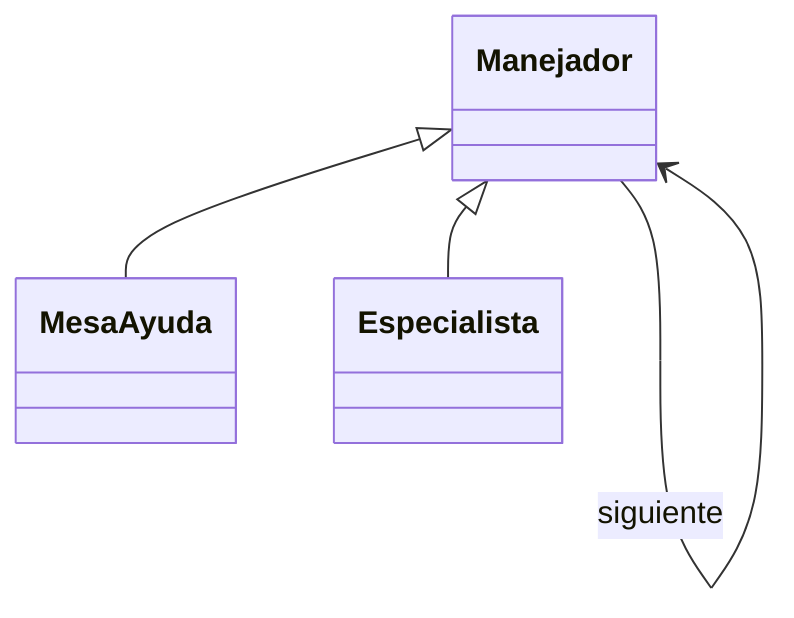

# Chain of Responsibility

Enrutamiento de solicitudes de soporte.

## Propósito

Dar a varios manejadores la oportunidad de resolver una solicitud en orden.

## Problema

Una incidencia puede corresponder al soporte básico o al especialista. El remitente desconoce quién puede atenderla.

## Estructura y participantes

## Implementación

`Manejador` comprueba si puede atender la categoría antes de delegar. El final de la cadena devuelve un resultado vacío.

## Ventajas y desventajas

- Ventaja. Se puede cambiar el orden y la composición sin tocar al remitente.
- Desventaja. El orden influye en el resultado y pueden quedar solicitudes sin atender.

## Cuándo usarlo

Cuando varios candidatos pueden resolver una solicitud.

## Cuándo evitarlo

Cuando una búsqueda directa por clave basta.

## Patrones relacionados

Command convierte la petición en un objeto. Chain of Responsibility decide quién la tramita.

[Ver código](../../src/main/java/com/neol/patterns/comportamiento/chainofresponsibility/Demo.java) · [Ver pruebas](../../src/test/java/com/neol/patterns/comportamiento/chainofresponsibility/PatronTest.java)
