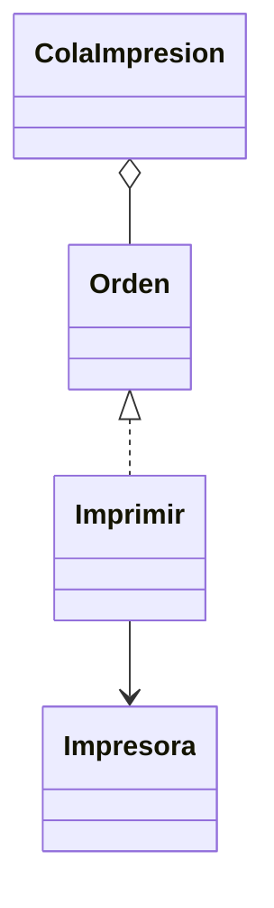

# Command

Cola de tareas para una impresora.

## Propósito

Encapsular una petición y sus parámetros como un objeto ejecutable.

## Problema

La interfaz encola impresiones para procesarlas más tarde sin depender del dispositivo.

## Estructura y participantes

## Implementación

`Imprimir` conserva el texto y la impresora receptora. La cola invoca el contrato `Orden` en orden de llegada.

## Ventajas y desventajas

- Ventaja. Permite diferir y agrupar operaciones.
- Desventaja. Hay que representar cada tipo de operación mediante un comando.

## Cuándo usarlo

Cuando una operación debe encolarse, registrarse o ejecutarse más tarde.

## Cuándo evitarlo

Cuando basta con llamar al receptor directamente.

## Patrones relacionados

Strategy intercambia algoritmos para una actividad. Command representa una petición completa.

[Ver código](../../src/main/java/com/neol/patterns/comportamiento/command/Demo.java) · [Ver pruebas](../../src/test/java/com/neol/patterns/comportamiento/command/PatronTest.java)
