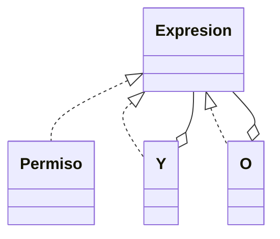

# Interpreter

Evaluación de reglas para habilitar funciones.

## Propósito

Representar una gramática pequeña mediante expresiones evaluables.

## Problema

Las reglas pueden combinar permisos mediante operadores lógicos y deben evaluarse contra usuarios distintos.

## Estructura y participantes

## Implementación

La gramática es `expresión ::= permiso | Y(expresión, expresión) | O(expresión, expresión)`. El cliente construye el árbol con Java. Cada nodo interpreta su regla contra el conjunto de permisos.

## Ventajas y desventajas

- Ventaja. Las reglas se componen y se pueden reutilizar con distintos contextos.
- Desventaja. Una gramática extensa genera muchos tipos y puede requerir un analizador dedicado.

## Cuándo usarlo

Cuando hay un lenguaje de reglas pequeño y estable.

## Cuándo evitarlo

Cuando el lenguaje necesita análisis sintáctico complejo o ejecución de alto rendimiento.

## Patrones relacionados

Composite describe la forma del árbol. Interpreter da significado a cada nodo según una gramática.

[Ver código](../../src/main/java/com/neol/patterns/comportamiento/interpreter/Demo.java) · [Ver pruebas](../../src/test/java/com/neol/patterns/comportamiento/interpreter/PatronTest.java)
