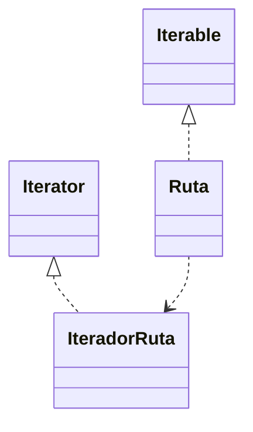

# Iterator

Recorrido de una ruta de reparto en orden inverso.

## Propósito

Recorrer un agregado sin revelar su almacenamiento ni mezclar su estado con el del recorrido.

## Problema

Dos repartidores deben consultar las mismas paradas con posiciones de recorrido independientes.

## Estructura y participantes

## Implementación

`Ruta` copia la lista y fabrica un iterador por recorrido. `IteradorRuta` mantiene un índice que avanza desde la última parada hacia la primera.

## Ventajas y desventajas

- Ventaja. Admite recorridos simultáneos y el bucle `for` de Java.
- Desventaja. Un orden adicional exige otra política de recorrido.

## Cuándo usarlo

Cuando el agregado tiene un orden de iteración propio.

## Cuándo evitarlo

Cuando el iterador de una colección estándar ya satisface el contrato.

## Patrones relacionados

Visitor separa la operación aplicada a cada tipo. Iterator determina cómo se accede a los elementos.

[Ver código](../../src/main/java/com/neol/patterns/comportamiento/iterator/Demo.java) · [Ver pruebas](../../src/test/java/com/neol/patterns/comportamiento/iterator/PatronTest.java)
