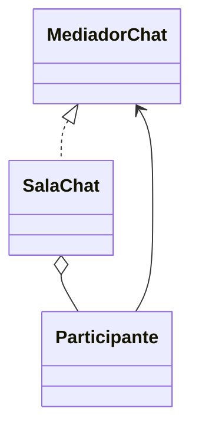

# Mediator

Chat de un equipo de trabajo.

## Propósito

Centralizar las reglas de comunicación entre participantes.

## Problema

Con comunicación directa, cada participante debe conocer a todos los demás y aplicar las reglas de la sala.

## Estructura y participantes

## Implementación

Un `Participante` envía al mediador. `SalaChat` registra a los participantes y entrega el mensaje a los demás miembros.

## Ventajas y desventajas

- Ventaja. Reduce las dependencias directas entre participantes.
- Desventaja. Una sala con demasiadas reglas puede resultar difícil de mantener.

## Cuándo usarlo

Cuando muchos objetos interactúan con reglas compartidas.

## Cuándo evitarlo

Cuando la comunicación es simple y directa.

## Patrones relacionados

Observer notifica eventos a suscriptores. Mediator controla cómo se comunican los participantes.

[Ver código](../../src/main/java/com/neol/patterns/comportamiento/mediator/Demo.java) · [Ver pruebas](../../src/test/java/com/neol/patterns/comportamiento/mediator/PatronTest.java)
