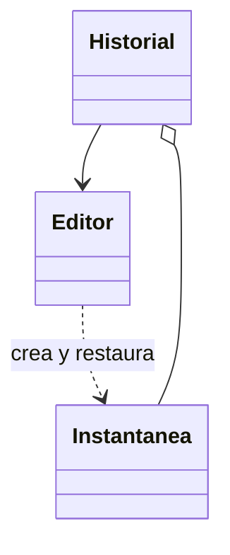

# Memento

Historial de borradores en un editor.

## Propósito

Guardar y restaurar el estado sin exponer su representación.

## Problema

El historial debe permitir deshacer cambios sin conocer los campos del editor.

## Estructura y participantes

## Implementación

El editor crea una `Instantanea` opaca con su texto. `Historial` conserva las instantáneas en una pila y se las devuelve al editor para deshacer.

## Ventajas y desventajas

- Ventaja. El historial queda separado de la representación del editor.
- Desventaja. Guardar copias completas puede consumir mucha memoria.

## Cuándo usarlo

Cuando importa restaurar estados de un objeto encapsulado.

## Cuándo evitarlo

Cuando un registro de cambios pequeños es suficiente y el estado es voluminoso.

## Patrones relacionados

Command puede deshacer aplicando una operación inversa. Memento recupera un estado almacenado.

[Ver código](../../src/main/java/com/neol/patterns/comportamiento/memento/Demo.java) · [Ver pruebas](../../src/test/java/com/neol/patterns/comportamiento/memento/PatronTest.java)
