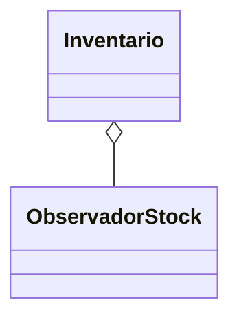

# Observer

Alertas de reposición de un producto.

## Propósito

Notificar cambios a suscriptores registrados dinámicamente.

## Problema

El inventario debe avisar a varios interesados cuando vuelve a haber existencias.

## Estructura y participantes

## Implementación

El inventario emite un evento al pasar de agotado a disponible. Una copia de la lista permite cancelar suscripciones desde una notificación.

## Ventajas y desventajas

- Ventaja. El emisor depende de un contrato pequeño y los oyentes son intercambiables.
- Desventaja. Un oyente lento retrasa las notificaciones síncronas.

## Cuándo usarlo

Cuando hay un evento con varios destinatarios variables.

## Cuándo evitarlo

Cuando el emisor requiere una respuesta obligatoria de un único colaborador.

## Patrones relacionados

Mediator aplica reglas entre participantes. Observer difunde cambios del sujeto a sus suscriptores.

[Ver código](../../src/main/java/com/neol/patterns/comportamiento/observer/Demo.java) · [Ver pruebas](../../src/test/java/com/neol/patterns/comportamiento/observer/PatronTest.java)
