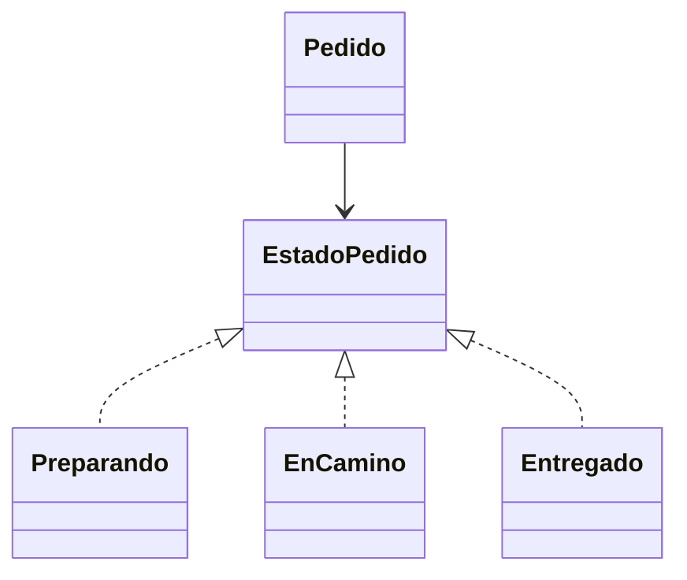

# State

Flujo de envío de un pedido.

## Propósito

Delegar las operaciones al objeto que representa el estado actual.

## Problema

Despachar y entregar tienen reglas distintas según la etapa del pedido.

## Estructura y participantes

## Implementación

`Pedido` delega la transición a su estado y adopta el resultado. El estado rechaza con una excepción las operaciones que no admite.

## Ventajas y desventajas

- Ventaja. Las transiciones válidas quedan junto al estado que las permite.
- Desventaja. Una máquina grande puede dispersar la visión global del flujo.

## Cuándo usarlo

Cuando varias operaciones cambian según el estado y las transiciones importan.

## Cuándo evitarlo

Cuando una tabla pequeña describe todo el flujo con claridad.

## Patrones relacionados

Una Strategy suele elegirse por configuración. En State las operaciones del dominio provocan las transiciones.

[Ver código](../../src/main/java/com/neol/patterns/comportamiento/state/Demo.java) · [Ver pruebas](../../src/test/java/com/neol/patterns/comportamiento/state/PatronTest.java)
