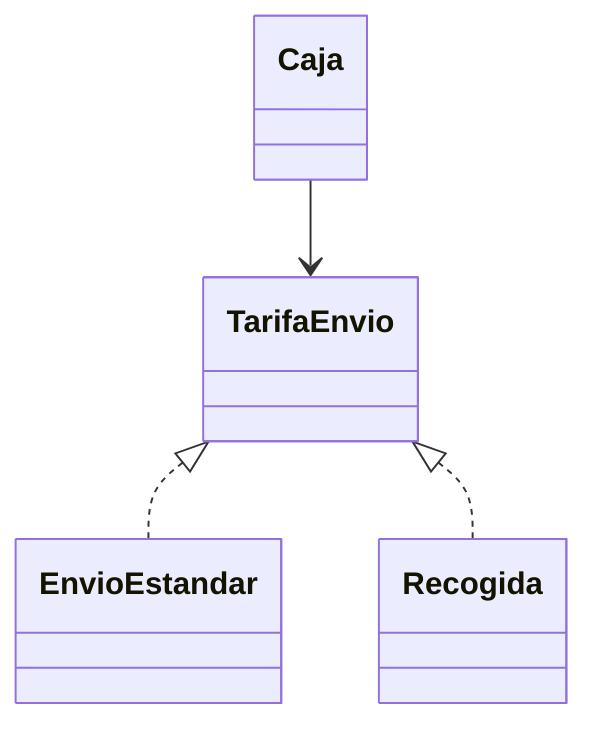

# Strategy

Cálculo del precio de un envío.

## Propósito

Hacer intercambiables algoritmos que resuelven una misma tarea.

## Problema

La tienda ofrece entrega a domicilio y recogida. Cada modalidad tiene una regla de coste.

## Estructura y participantes

## Implementación

`Caja` delega el coste a la tarifa configurada y lo suma al subtotal. Los importes son céntimos. La tarifa estándar deja de cobrar a partir de 50 euros.

## Ventajas y desventajas

- Ventaja. Añadir una tarifa deja intacta la lógica de caja.
- Desventaja. El cliente debe conocer qué estrategia necesita.

## Cuándo usarlo

Cuando hay políticas alternativas con el mismo contrato.

## Cuándo evitarlo

Cuando solo existe una regla estable.

## Patrones relacionados

Template Method varía pasos mediante herencia. Strategy delega el cálculo a un objeto intercambiable.

[Ver código](../../src/main/java/com/neol/patterns/comportamiento/strategy/Demo.java) · [Ver pruebas](../../src/test/java/com/neol/patterns/comportamiento/strategy/PatronTest.java)
