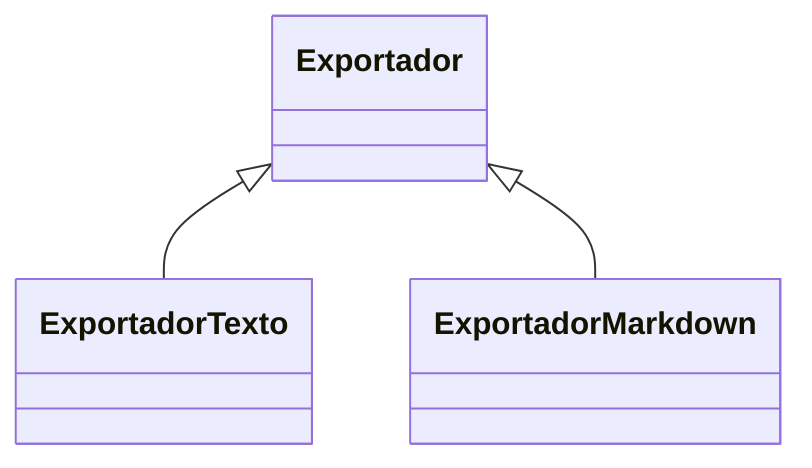

# Template Method

Exportación de listados de productos.

## Propósito

Fijar el orden de un algoritmo y permitir variantes en pasos concretos.

## Problema

Toda exportación incluye una cabecera y una línea por producto. El formato de cada línea depende del destino.

## Estructura y participantes

## Implementación

El método final `exportar` escribe primero la cabecera y después las filas. Las subclases implementan el formato de las dos partes.

## Ventajas y desventajas

- Ventaja. Reutiliza el orden del proceso y sus invariantes.
- Desventaja. Las variantes dependen del contrato de herencia de la clase base.

## Cuándo usarlo

Cuando la secuencia es estable y solo cambian algunos pasos.

## Cuándo evitarlo

Cuando los clientes necesitan combinar pasos de forma dinámica.

## Patrones relacionados

Strategy intercambia un colaborador por composición. Template Method ofrece puntos de variación en una secuencia heredada.

[Ver código](../../src/main/java/com/neol/patterns/comportamiento/templatemethod/Demo.java) · [Ver pruebas](../../src/test/java/com/neol/patterns/comportamiento/templatemethod/PatronTest.java)
