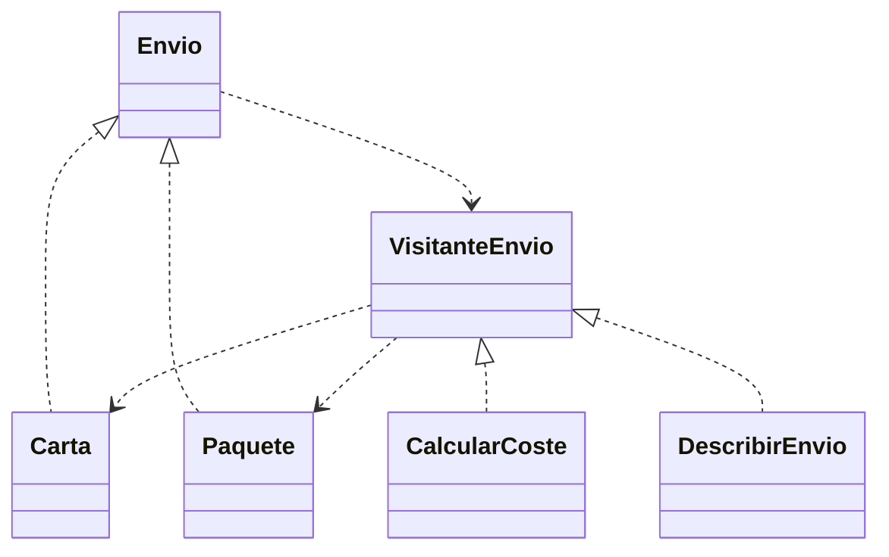

# Visitor

Cálculo de tarifas y descripción de envíos.

## Propósito

Añadir operaciones a un conjunto estable de tipos mediante doble despacho.

## Problema

Los paquetes y las cartas tienen datos distintos. Cada nueva operación debería poder añadirse fuera de esas clases.

## Estructura y participantes

## Implementación

Cada tipo llama a la sobrecarga `visitar` que coincide con su tipo concreto. Dos visitantes devuelven resultados distintos sin modificar los envíos.

## Ventajas y desventajas

- Ventaja. Permite incorporar operaciones independientes sobre tipos existentes.
- Desventaja. Introducir otro tipo de envío exige actualizar el contrato y todos los visitantes.

## Cuándo usarlo

Cuando los tipos son estables y las operaciones aumentan.

## Cuándo evitarlo

Cuando los tipos de elemento cambian con frecuencia.

## Patrones relacionados

Iterator recorre elementos. Visitor selecciona la operación según el tipo de cada elemento.

[Ver código](../../src/main/java/com/neol/patterns/comportamiento/visitor/Demo.java) · [Ver pruebas](../../src/test/java/com/neol/patterns/comportamiento/visitor/PatronTest.java)
