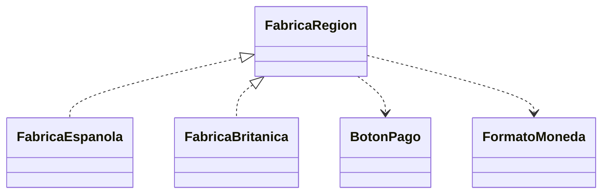

# Abstract Factory

Interfaz de facturación localizada.

## Propósito

Crear productos que pertenecen a una misma familia.

## Problema

Las etiquetas de pago y los formatos monetarios deben coincidir con el idioma elegido.

## Estructura y participantes

## Implementación

Cada fábrica entrega una etiqueta y un formateador de moneda de la misma región.

## Ventajas y desventajas

- Ventaja. Permite cambiar una familia completa desde un único punto.
- Desventaja. Añadir un tipo de producto afecta a todas las fábricas.

## Cuándo usarlo

Cuando el cliente requiere varios productos compatibles.

## Cuándo evitarlo

Cuando solo hay un producto configurable.

## Patrones relacionados

Factory Method varía un punto de creación en una jerarquía.

[Ver código](../../src/main/java/com/neol/patterns/creacionales/abstractfactory/) · [Ver pruebas](../../src/test/java/com/neol/patterns/creacionales/abstractfactory/PatronTest.java)
