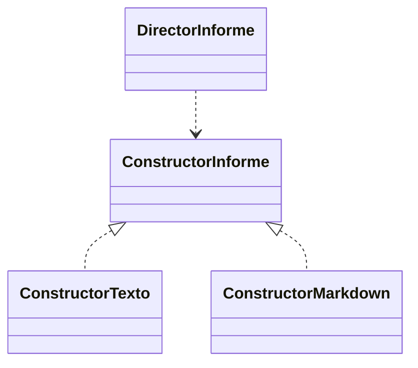

# Builder

Generación de informes de ventas.

## Propósito

Separar los pasos de construcción de la representación final.

## Problema

Un informe debe incluir los mismos datos en formato de texto o Markdown.

## Estructura y participantes

## Implementación

El director ordena título y total. Cada constructor aplica su propio formato y entrega el informe completo.

## Ventajas y desventajas

- Ventaja. Reutiliza la secuencia de montaje.
- Desventaja. Añade tipos para representar los pasos.

## Cuándo usarlo

Cuando varias representaciones siguen una misma receta.

## Cuándo evitarlo

Cuando una interpolación directa resuelve un formato único.

## Patrones relacionados

Abstract Factory crea familias; Builder monta un producto mediante pasos.

[Ver código](../../src/main/java/com/neol/patterns/creacionales/builder/) · [Ver pruebas](../../src/test/java/com/neol/patterns/creacionales/builder/PatronTest.java)
