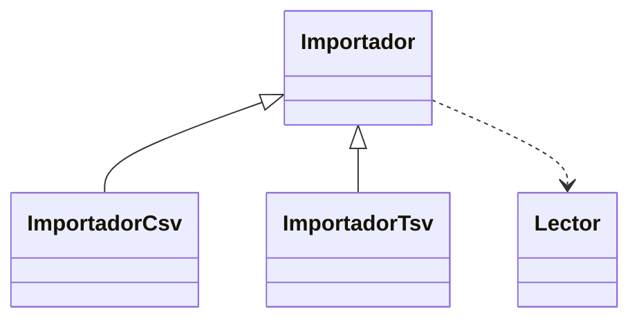

# Factory Method

Importación de listas de contactos.

## Propósito

Delegar la creación del lector a las subclases.

## Problema

El flujo de importación es común y cada formato tiene su propio separador.

## Estructura y participantes

## Implementación

`Importador` cuenta los contactos a través de `Lector`. Cada creador concreto proporciona un lector para su formato.

## Ventajas y desventajas

- Ventaja. El flujo común se conserva al añadir formatos.
- Desventaja. Cada variante requiere un creador.

## Cuándo usarlo

Cuando una operación base necesita un colaborador variable.

## Cuándo evitarlo

Cuando basta con pasar un lector ya construido.

## Patrones relacionados

Abstract Factory coordina varios productos de una familia.

[Ver código](../../src/main/java/com/neol/patterns/creacionales/factorymethod/) · [Ver pruebas](../../src/test/java/com/neol/patterns/creacionales/factorymethod/PatronTest.java)
