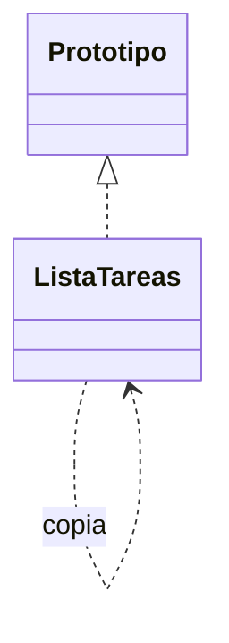

# Prototype

Duplicación de una lista de tareas a partir de una plantilla.

## Propósito

Crear objetos copiando un ejemplar existente.

## Problema

Una plantilla configurada debe poder modificarse después de copiarla sin alterar el original.

## Estructura y participantes

## Implementación

`ListaTareas` copia su colección interna. Las tareas son cadenas inmutables y pueden compartirse.

## Ventajas y desventajas

- Ventaja. Conserva la configuración actual del ejemplar.
- Desventaja. Cada tipo debe definir qué estado se duplica.

## Cuándo usarlo

Cuando se crean variantes de objetos configurados en tiempo de ejecución.

## Cuándo evitarlo

Cuando el estado es trivial o tiene recursos que no se pueden copiar.

## Patrones relacionados

Builder ensambla desde pasos explícitos. Prototype parte de un objeto configurado.

[Ver código](../../src/main/java/com/neol/patterns/creacionales/prototype/) · [Ver pruebas](../../src/test/java/com/neol/patterns/creacionales/prototype/PatronTest.java)
