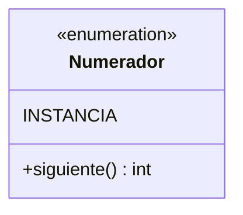

# Singleton

Numeración de tickets en una oficina.

## Propósito

Compartir una única fuente de números en el proceso.

## Problema

Si cada mostrador crea su propio contador, puede emitir números duplicados.

## Estructura y participantes

## Implementación

El enum controla la instancia y `AtomicInteger` asigna números de forma segura entre hilos.

## Ventajas y desventajas

- Ventaja. Centraliza la secuencia.
- Desventaja. Introduce estado global que dificulta el aislamiento.

## Cuándo usarlo

Cuando el ámbito del estado coincide con el del cargador de clases.

## Cuándo evitarlo

Cuando cada oficina necesita una secuencia independiente.

## Patrones relacionados

Factory Method delega la elección de un producto y puede crear uno por llamada.

[Ver código](../../src/main/java/com/neol/patterns/creacionales/singleton/) · [Ver pruebas](../../src/test/java/com/neol/patterns/creacionales/singleton/PatronTest.java)
