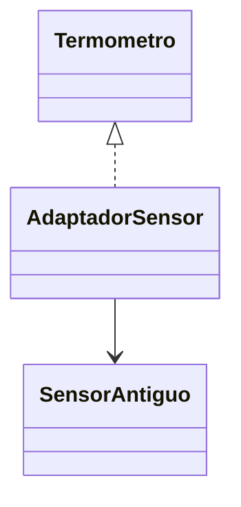

# Adapter

Lectura de temperaturas de un sensor antiguo.

## Propósito

Traducir una interfaz existente a la que espera el cliente.

## Problema

La aplicación muestra grados Celsius y el sensor entrega Fahrenheit.

## Estructura y participantes

## Implementación

El adaptador implementa `Termometro`, consulta `SensorAntiguo` y convierte el resultado.

## Ventajas y desventajas

- Ventaja. Reutiliza el sensor sin cambiarlo.
- Desventaja. Cada conversión requiere mantener sus supuestos sobre unidades.

## Cuándo usarlo

Cuando existe una implementación útil con una interfaz incompatible.

## Cuándo evitarlo

Cuando puedes alinear ambas interfaces directamente.

## Patrones relacionados

Bridge separa dos dimensiones de diseño desde el principio.

[Ver código](../../src/main/java/com/neol/patterns/estructurales/adapter/) · [Ver pruebas](../../src/test/java/com/neol/patterns/estructurales/adapter/PatronTest.java)
