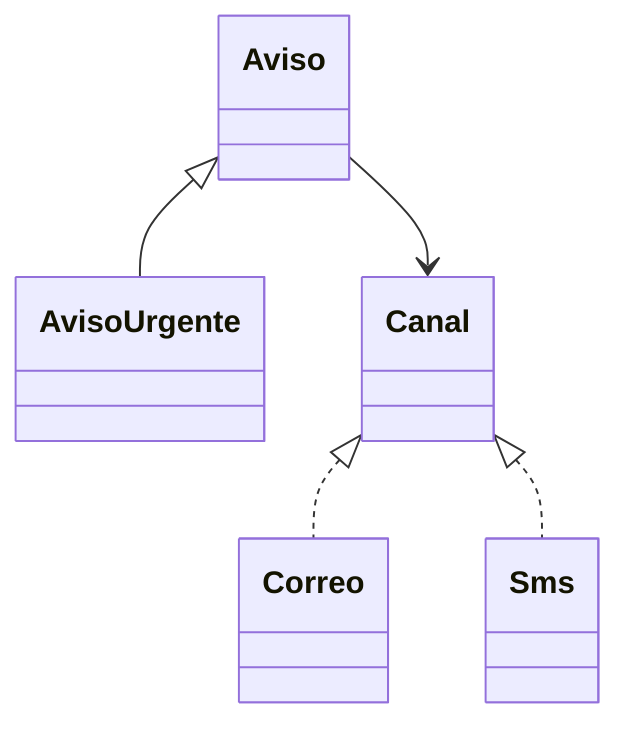

# Bridge

Envío de avisos normales y urgentes por varios canales.

## Propósito

Separar el tipo de aviso del mecanismo de entrega.

## Problema

Crear una clase por cada combinación de prioridad y canal multiplica las variantes.

## Estructura y participantes

## Implementación

`Aviso` y `AvisoUrgente` deciden el contenido. `Correo` y `Sms` representan cómo se entrega. Los canales simulan la entrega devolviendo texto.

## Ventajas y desventajas

- Ventaja. Cada dimensión se puede ampliar de forma independiente.
- Desventaja. Hay que definir una interfaz de canal que sirva a todos los avisos.

## Cuándo usarlo

Cuando dos familias de variantes se combinan libremente.

## Cuándo evitarlo

Cuando solo hay una dimensión de cambio.

## Patrones relacionados

Adapter integra una interfaz preexistente. Bridge diseña las dos dimensiones para evolucionar por separado.

[Ver código](../../src/main/java/com/neol/patterns/estructurales/bridge/) · [Ver pruebas](../../src/test/java/com/neol/patterns/estructurales/bridge/PatronTest.java)
