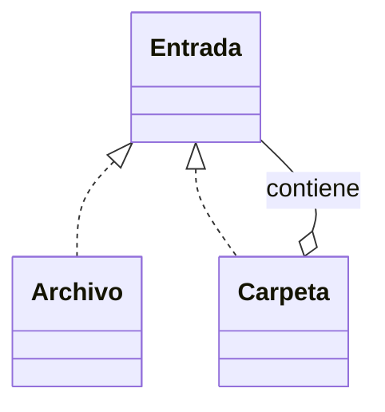

# Composite

Cálculo del tamaño de carpetas y archivos.

## Propósito

Tratar hojas y grupos mediante una misma operación.

## Problema

Las carpetas pueden contener archivos y otras carpetas a cualquier profundidad.

## Estructura y participantes

## Implementación

`Archivo` aporta sus bytes. `Carpeta` suma los tamaños de sus hijos. Copiar la lista al construir fija la estructura del árbol.

## Ventajas y desventajas

- Ventaja. El cliente puede consultar cualquier nodo del árbol de la misma forma.
- Desventaja. La interfaz común debe limitarse a operaciones compartidas.

## Cuándo usarlo

Cuando el dominio se organiza como un árbol de partes y conjuntos.

## Cuándo evitarlo

Cuando el dominio exige distinguir estrictamente hojas y agrupaciones.

## Patrones relacionados

Decorator también implementa la interfaz de su componente, pero añade comportamiento a un único objeto.

[Ver código](../../src/main/java/com/neol/patterns/estructurales/composite/) · [Ver pruebas](../../src/test/java/com/neol/patterns/estructurales/composite/PatronTest.java)
