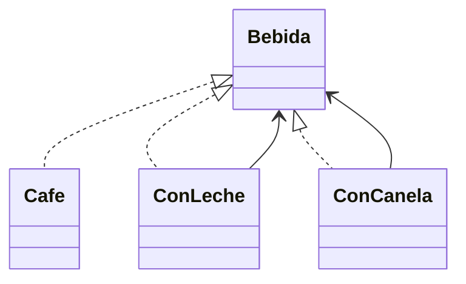

# Decorator

Personalización del precio de una bebida.

## Propósito

Añadir responsabilidades mediante envoltorios combinables.

## Problema

Una cafetería permite combinar extras sin mantener una clase por combinación.

## Estructura y participantes

## Implementación

Cada decorador conserva una `Bebida`, consulta su precio y suma el coste del extra en céntimos.

## Ventajas y desventajas

- Ventaja. Combina extras en tiempo de ejecución.
- Desventaja. Las cadenas largas dificultan localizar qué objeto aplica un cambio.

## Cuándo usarlo

Cuando las responsabilidades son opcionales y apilables.

## Cuándo evitarlo

Cuando hay una única variante fija.

## Patrones relacionados

Proxy usa la misma interfaz para gestionar el acceso al objeto representado.

[Ver código](../../src/main/java/com/neol/patterns/estructurales/decorator/) · [Ver pruebas](../../src/test/java/com/neol/patterns/estructurales/decorator/PatronTest.java)
