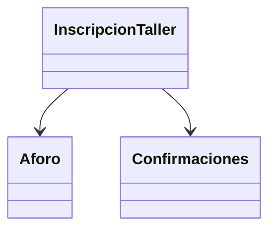

# Facade

Alta de asistentes en un taller.

## Propósito

Reunir las operaciones de un subsistema detrás de una interfaz sencilla.

## Problema

Cada cliente tendría que verificar plazas, reservar una y enviar la confirmación en orden.

## Estructura y participantes

## Implementación

La fachada pide una reserva al aforo y solo confirma si la reserva pudo hacerse. Los dos colaboradores se usan en memoria.

## Ventajas y desventajas

- Ventaja. Centraliza la secuencia que comparten los clientes.
- Desventaja. Una fachada que acumula casos no relacionados puede crecer sin control.

## Cuándo usarlo

Cuando muchos clientes repiten la misma secuencia de llamadas.

## Cuándo evitarlo

Cuando el cliente necesita controlar el subsistema con más precisión.

## Patrones relacionados

Mediator coordina colaboradores que interactúan entre sí. Facade ofrece una puerta de entrada al subsistema.

[Ver código](../../src/main/java/com/neol/patterns/estructurales/facade/) · [Ver pruebas](../../src/test/java/com/neol/patterns/estructurales/facade/PatronTest.java)
