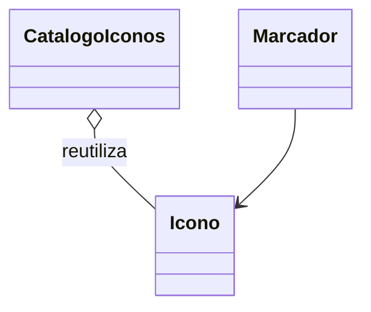

# Flyweight

Marcadores de mapa con iconos compartidos.

## Propósito

Reutilizar el estado intrínseco común a muchos objetos.

## Problema

Muchos puntos del mapa repiten el mismo símbolo aunque sus coordenadas sean distintas.

## Estructura y participantes

## Implementación

`Icono` guarda el símbolo inmutable y `Marcador` conserva las coordenadas externas. El catálogo reutiliza un icono por símbolo.

## Ventajas y desventajas

- Ventaja. Reduce el estado duplicado cuando abundan las repeticiones.
- Desventaja. El catálogo retiene cada clave que recibe durante su vida útil.

## Cuándo usarlo

Cuando hay muchas instancias y pocos valores intrínsecos diferentes.

## Cuándo evitarlo

Cuando casi todos los valores son únicos o el estado compartido debe mutar.

## Patrones relacionados

Singleton controla la unicidad global de un tipo. Flyweight comparte una instancia por clave dentro de un catálogo.

[Ver código](../../src/main/java/com/neol/patterns/estructurales/flyweight/) · [Ver pruebas](../../src/test/java/com/neol/patterns/estructurales/flyweight/PatronTest.java)
