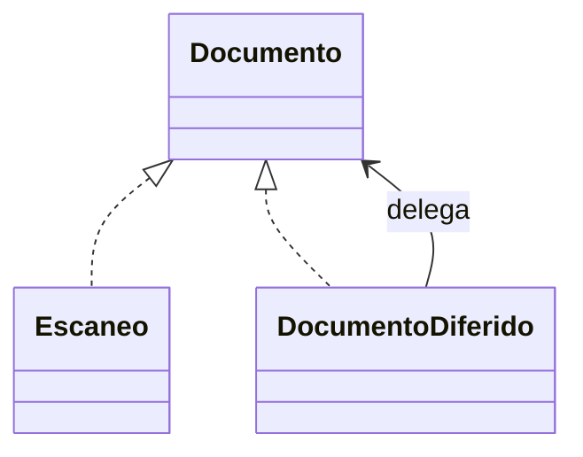

# Proxy

Carga diferida de un documento digitalizado.

## Propósito

Controlar el acceso al objeto a través de su misma interfaz.

## Problema

Cargar todos los escaneos al abrir un catálogo desperdicia trabajo.

## Estructura y participantes

## Implementación

El proxy virtual recibe un cargador. La primera lectura crea el documento y las siguientes reutilizan el objeto cargado.

## Ventajas y desventajas

- Ventaja. Evita el coste inicial de documentos que nadie lee.
- Desventaja. Traslada el coste a la primera lectura.

## Cuándo usarlo

Cuando el objeto es caro y puede que no llegue a usarse.

## Cuándo evitarlo

Cuando es necesario comprobar la disponibilidad de todos los documentos al iniciar.

## Patrones relacionados

Decorator agrega capacidades. Proxy administra el acceso al objeto representado.

[Ver código](../../src/main/java/com/neol/patterns/estructurales/proxy/) · [Ver pruebas](../../src/test/java/com/neol/patterns/estructurales/proxy/PatronTest.java)
